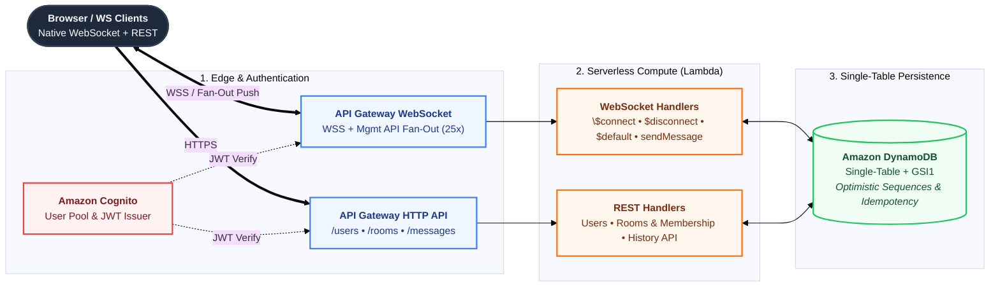

# Real-Time Chat with Presence

A serverless real-time chat backend on AWS using DynamoDB single-table design, WebSocket API Gateway, Cognito JWT authentication, idempotent message sequencing, and bounded-concurrency room fan-out.

---

## Architecture Overview



### Key Capabilities

- **Authentication:** Cognito JWT validation via Lambda Request Authorizer (`token` query parameter or `Authorization` header).
- **Connection & Presence:** Atomic `$connect` registration with presence counter, `CONN#<id>/OWNER` reverse lookup for `$disconnect`, and heartbeat tracking.
- **Rooms & Messaging:** Direct and group rooms with monotonic per-room sequence numbers, client idempotency keys, and paginated message history (`GET /rooms/{roomId}/messages`).
- **Bounded Fan-Out:** Parallel DynamoDB lookups (`pMap`, 10) and WebSocket deliveries (`pMapSettled`, 25) with 429 jittered retry and 410 stale pruning.
- **Infrastructure as Code:** CloudFormation templates (`infra/`) for Cognito, DynamoDB, API Gateway (HTTP + WebSocket), and Lambdas.

---

## Getting Started

### Prerequisites

- [Node.js](https://nodejs.org/) v22+
- [Docker](https://www.docker.com/) (for DynamoDB Local integration tests)

### Install & Common Commands

```bash
npm install
```

| Command | Description |
| :--- | :--- |
| `npm run build` | Bundles Lambda handlers into `dist/` |
| `npm run typecheck` | Runs `tsc --noEmit` |
| `npm run test:unit` | Runs unit tests with Vitest |
| `npm run test:integration` | Runs integration tests against DynamoDB Local (`DYNAMODB_ENDPOINT=http://localhost:8000`) |
| `npm run lint` | Checks formatting and lint rules with Biome |
| `npm run format` | Formats files with Biome |
| `npm run benchmark:fanout` | Runs the live AWS multi-client fan-out benchmark |

### Running Local Integration Tests

```powershell
docker compose up -d dynamodb-local
$env:DYNAMODB_ENDPOINT="http://localhost:8000"
npm run test:integration
```

### Deployment

See [DEPLOYMENT.md](DEPLOYMENT.md) or run:

```bash
bash scripts/deploy/deploy.sh dev
```

---

## Documentation

- [Project Structure](docs/project-structure.md)
- [Single-Table DynamoDB Key Schema](docs/dynamodb-keys.md)
- [Room Fan-Out Architecture & Benchmarks](docs/fanout-benchmarks.md) (`50`-member AWS `p50`/`p95` results)
- [DynamoDB Access Patterns](docs/access-pattern.md)
- [DynamoDB Implementation Guidelines](docs/dynamodb-implementation-guidelines.md)
- [WebSocket Authentication](docs/websocket-auth.md)
